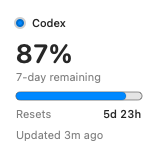
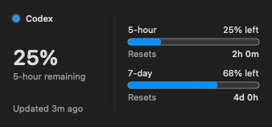

[简体中文](./README.zh-CN.md)

# Codex Usage Widget

A privacy-minded native macOS app and WidgetKit extension that show your remaining Codex usage windows from the Codex installation already signed in on your Mac.

<p align="center">
  
  &nbsp;&nbsp;
  
</p>

<p align="center"><sub>The screenshots use synthetic preview data, not a real account.</sub></p>

> [!IMPORTANT]
> This repository currently distributes source code only. It does not yet provide a Developer ID-signed and notarized download. To use the widget today, build and sign it locally with Xcode by following the steps below.

## Features

- Native Small and Medium macOS desktop widgets using the glanceable **A · Clarity** design.
- Shows five-hour and seven-day Codex usage windows when the account exposes them.
- Handles single-window, dual-window, unknown-duration, stale, paused, signed-out, and error states without inventing data.
- Supports Default, Dark, and Mono/tinted icon appearances created with Apple Icon Composer.
- A native dashboard with a focused usage summary, system toolbar, background settings, and expandable connection details.
- Closing the dashboard keeps updates running in the menu bar and hides the Dock icon. Reopen it from the menu-bar icon; choose Quit to stop the app.
- Refresh, pause/resume, safe Codex re-detection, optional Launch at Login, and sanitized diagnostics.
- No telemetry, web scraping, API-key billing integration, or direct credential-file access.

While running, the host checks account limits about every 30 seconds and also responds to rate-limit notifications. Opening the dashboard or menu, waking the Mac, or restoring the network checks again if the last successful reading is at least 30 seconds old, and requests a Widget update. A newer cached reading can be sent to the Widget immediately. Clicking the Widget opens the dashboard and explicitly refreshes. Temporary connection failures retry quickly at first, then about every 5 minutes after repeated failures; a successful reconnect restores regular polling. Changed usage, reset times, and status request a Widget update immediately; timestamp-only changes are combined into a 15-minute freshness update to conserve WidgetKit's reload budget. The dashboard's **Refresh** button and the menu's **Refresh Now** button explicitly request a Widget update. WidgetKit can defer or throttle redraws, so the desktop widget is not guaranteed to update every minute or second. Every snapshot includes an updated or stale state.

## Requirements

- macOS 14 or later.
- Xcode 26 or later with a Swift 6 toolchain. The current project was validated with Xcode 27.1.
- An Apple ID/team available to Xcode for local code signing. The host app and Widget extension must use the same Team.
- A current Codex-capable ChatGPT desktop app or Codex CLI installation, signed in to an account that exposes Codex usage limits.

A free Personal Team may be usable for local testing, but Apple can require periodic re-signing and this project has not validated that as a long-term installation path. A downloadable build for arbitrary users instead requires the maintainer's paid Developer ID signing and notarization; end users would not need Xcode for that future release.

The resolver checks the registered Codex/ChatGPT app, `ChatGPT.app` and `Codex.app` in system and user Applications folders, Homebrew locations, and `PATH`. Both the current `Contents/Resources/codex-cli/CodexCLI.app/Contents/MacOS/codex` layout and the older `Contents/Resources/codex` layout are supported. Developers may also provide an absolute path through `CODEX_USAGE_CODEX_PATH`.

## Install from source

1. Install the current [ChatGPT desktop app](https://chatgpt.com/download/) or Codex CLI and sign in.
2. Clone this repository:

   ```sh
   git clone https://github.com/henryue/CodexUsageWidget.git
   cd CodexUsageWidget
   ```

3. Open `CodexUsageWidget.xcodeproj` in Xcode.
4. Select the `CodexUsage` target, open **Signing & Capabilities**, enable automatic signing, and select your Team.
5. Repeat the same selection for the `CodexUsageWidget` target. Both targets must use the same Team.
6. If Xcode reports that a bundle identifier is unavailable, replace `com.henryyue.CodexUsage` with a unique reverse-DNS identifier you control, and set the Widget identifier to the same value plus `.Widget`.
7. Select the `CodexUsage` scheme and **My Mac**, then choose **Product › Run**.
8. For a stable installation, copy the resulting `Codex Usage.app` from Xcode's build products into `/Applications` or `~/Applications`, then launch that copy once.

The project uses the macOS team-prefixed App Group form:

```text
$(TeamIdentifierPrefix)com.henryyue.CodexUsageWidget
```

The same value is present in both targets. Apple documents that this macOS form identifies the signing team and doesn't require an App Group provisioning profile. If you customize it, change the host and Widget values together.

### Add the widget

1. Launch **Codex Usage** and choose **Refresh** in the dashboard toolbar.
2. Confirm that the app shows a current snapshot.
3. Right-click the desktop, choose **Edit Widgets**, search for **Codex Usage**, and add the Small or Medium widget.
4. Enable **Launch at Login** only if you want the host app to keep the snapshot refreshed after login.

### Common setup problems

- **Shared usage storage is unavailable:** confirm that both targets use the same signing Team, clean the build folder, and rebuild both targets.
- **Codex was not found:** install or update ChatGPT/Codex, sign in, then choose **Re-detect Codex**.
- **The widget is missing:** move the signed app to Applications, launch it once, and reopen the widget gallery.
- **The data is out of date:** open the host app and choose **Refresh**, or choose **Refresh Now** in its menu-bar panel; WidgetKit may delay the desktop redraw.

## Privacy and security model

- The host app is intentionally not sandboxed because it must launch the already-installed Codex executable. It uses `Process` with fixed arguments and never invokes a shell.
- The Widget extension remains sandboxed. It never launches Codex, reads account files, or makes network requests.
- The host reads usage through the local Codex app-server, reduces the response to remaining percentages, reset dates, duration labels, and status, then writes one atomic versioned snapshot to the shared App Group.
- The project never reads `~/.codex/auth.json`, browser cookies, Keychain tokens, or raw account pages.
- Sanitized diagnostics omit credentials, account identifiers, home-directory paths, raw protocol messages, and live usage values.

This is an unofficial community project and is not affiliated with or endorsed by OpenAI. Codex, ChatGPT, and OpenAI are trademarks of their respective owner.

## Build and test

Build without signing:

```sh
xcodebuild clean build \
  -project CodexUsageWidget.xcodeproj \
  -scheme CodexUsage \
  -configuration Release \
  -destination 'generic/platform=macOS' \
  -derivedDataPath /tmp/CodexUsageWidget-Release \
  CODE_SIGNING_ALLOWED=NO
```

Run the Swift package tests:

```sh
swift test \
  --disable-sandbox \
  --scratch-path /tmp/CodexUsageWidget-SPM
```

Run the Xcode test suite:

```sh
CUW_TEST_DIR="$(mktemp -d /tmp/CodexUsageWidget-Tests.XXXXXX)"

xcodebuild test \
  -project CodexUsageWidget.xcodeproj \
  -scheme CodexUsage \
  -destination 'platform=macOS' \
  -derivedDataPath "$CUW_TEST_DIR/DerivedData" \
  -resultBundlePath "$CUW_TEST_DIR/Tests.xcresult" \
  CODE_SIGNING_ALLOWED=NO \
  CODE_SIGNING_REQUIRED=NO
```

The optional `CodexUsageSmoke` executable performs a real local initialize/read handshake, reduces the response to the sanitized model, round-trips it through a temporary container, and confirms that its owned app-server process exits. It never prints live percentages.

See [PRIVACY.md](./PRIVACY.md) for the data-handling details and [SECURITY.md](./SECURITY.md) for responsible vulnerability reporting.

The scope and results of the current source validation are recorded in [Docs/VALIDATION.md](./Docs/VALIDATION.md).

## Uninstall

1. Turn off **Launch at Login** in the app or in **System Settings › General › Login Items**.
2. Quit Codex Usage.
3. Remove `Codex Usage.app` and remove the widget from the desktop.

The app does not install a launch-agent plist and does not modify ChatGPT, Codex, or their sign-in state.

## Limitations

- The local Codex app-server schema can change with future Codex releases.
- Refresh timing is controlled partly by WidgetKit.
- The current architecture is intended for direct/local distribution, not the Mac App Store, because the host launches an executable outside its bundle.
- A frictionless downloadable build still requires Developer ID signing, Hardened Runtime validation, notarization, packaging, and clean-machine installation testing.

## Contributing

Issues and pull requests are welcome. Please read [CONTRIBUTING.md](./CONTRIBUTING.md) before submitting a change.

## License

Codex Usage Widget is available under the [MIT License](./LICENSE).
